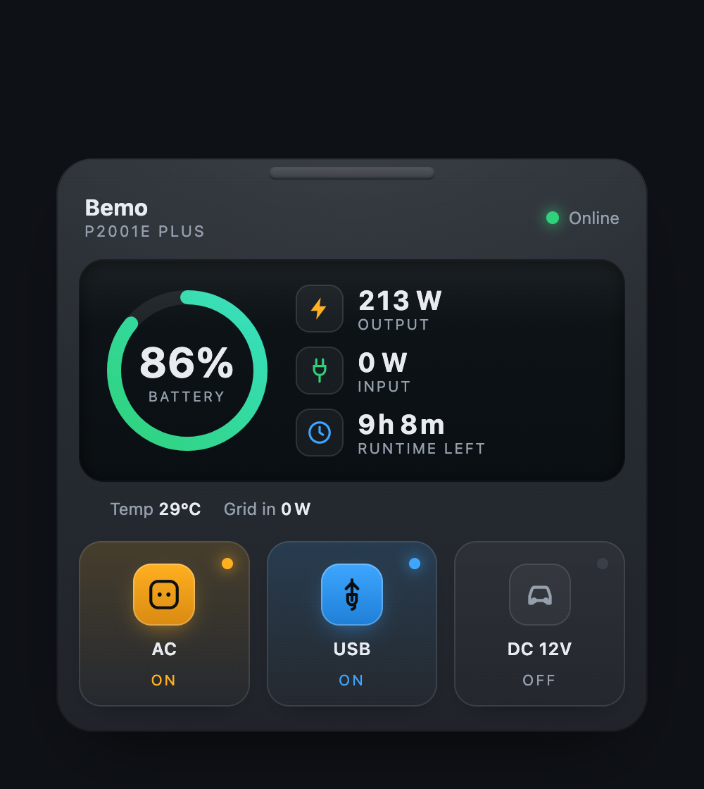
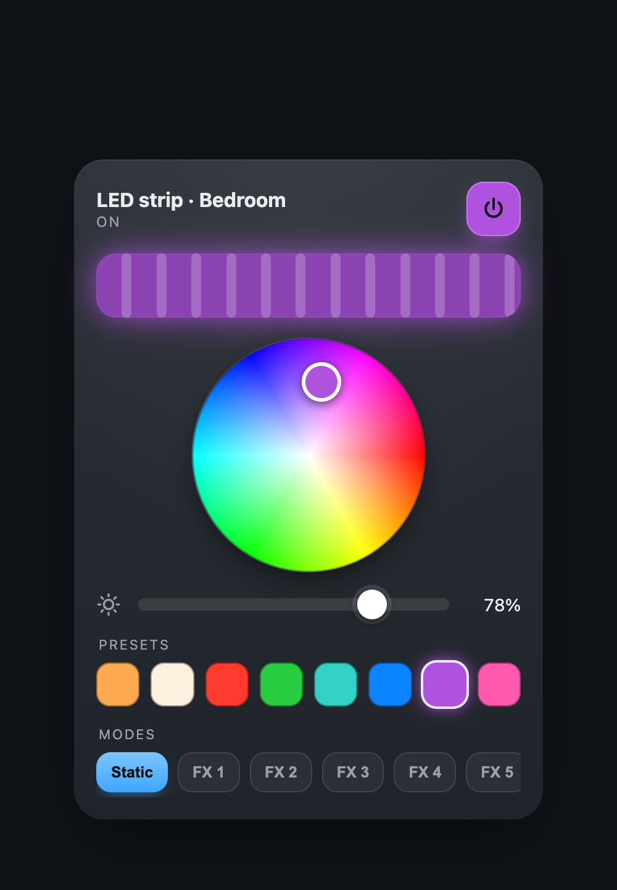

# Oukitel (Wonderfree) — Home Assistant integration

Control and monitor **Oukitel portable power stations** in Home Assistant —
the ones paired through the **Wonderfree** app (`com.quectel.commonappeu`),
sold under names like **Bemo**. Built and tested on an **Oukitel P2001E Plus**,
but nothing here is model-specific.

The station has **no local API of any kind** (see [Why cloud-only](#why-cloud-only)),
so this talks to the same Quectel cloud the app uses. The whole protocol was
reconstructed from the app and verified against the live endpoint.

[![hacs][hacs-badge]][hacs] [![license][license-badge]](LICENSE)

<p align="center">
  
  &nbsp;&nbsp;
  
</p>

---

## Features

- **Live telemetry** — battery %, total in/out power, AC charging input, DC
  input, device temperature, remaining charge / discharge time.
- **Output control** — AC, USB and 12 V DC outputs as switches (verified to
  physically toggle the station).
- **Config flow** — sign in with your Wonderfree account, pick the station.
- **Works while the station sleeps** — reads the cloud's stored last value, so
  entities don't flap to *unavailable*.
- **Bonus dashboard cards** — two polished custom Lovelace cards (below).

### Entities

| Platform | Entities |
|---|---|
| `sensor` | Battery Level · Total In / Out Power · AC In Power · DC In Power · Device Temperature · Charge / Discharge Remaining Time · AC Charging Limit |
| `switch` | AC Output · USB Output · DC (12 V) Output |

Entities are named `sensor.<station>_*` / `switch.<station>_*` (e.g.
`sensor.bemo_battery_level`).

---

## Install

### HACS (recommended)

1. HACS → ⋮ → **Custom repositories** → add
   `https://github.com/morozov/ha-oukitel-wonderfree`, category **Integration**.
2. Install **Oukitel (Wonderfree)**, then restart Home Assistant.
3. **Settings → Devices & Services → Add Integration → Oukitel (Wonderfree)**.

### Manual

Copy `custom_components/oukitel_wonderfree/` into your HA `config/custom_components/`
and restart.

### Account & sharing

You sign in with a **Wonderfree** account. If you log in to the app with
Google/Apple (no password), create a **second Wonderfree account** with an
email + password and **share the station to it** in the app
(*Share to Others* → QR, valid 30 min). Then add that account here — your main
credentials never touch Home Assistant, and access is revocable in one tap.

The region defaults to **EU**; `us` and `cn` are in `protocol.REGIONS`.

---

## Dashboard cards

Two self-contained custom Lovelace cards live in [`www/`](www) — no build step,
no dependencies. They're optional; the integration works without them.

**Install:** copy the `.js` files into `config/www/`, then
**Settings → Dashboards → ⋮ → Resources → Add** each as a **JavaScript Module**
(`/local/oukitel-station-card.js`, `/local/glow-light-card.js`). Add the cards
in the dashboard editor.

### `oukitel-station-card` — station panel

A station-shaped panel: a battery ring, live in/out power, remaining runtime,
and three tactile toggles for the AC / USB / DC outputs.

```yaml
type: custom:oukitel-station-card
# all entity ids optional — default to sensor.bemo_* / switch.bemo_*
name: Bemo
model: P2001E Plus
soc: sensor.bemo_battery_level
out: sensor.bemo_total_out_power
in: sensor.bemo_total_in_power
ac: switch.bemo_ac_output
usb: switch.bemo_usb_output
dc: switch.bemo_dc_output
```

### `glow-light-card` — RGB light control

A generic RGB light card (works with **any** `light` entity): a live-colour
glow bar, a draggable HS colour wheel, brightness, quick presets, and effect
modes.

```yaml
type: custom:glow-light-card
entity: light.your_rgb_light
name: LED strip
# optional: rename the numbered effects
effect_names:
  "0": Static
  "1": Rainbow
```

---

## Why cloud-only

The station has no local interface. This was measured on a live, responsive
unit, not assumed:

| Probe | Result |
|---|---|
| All 65535 TCP ports (host answering `RST` throughout) | **0 open** |
| Tuya `6668`, Modbus `502`, MQTT `1883`, HTTP `80`/`443` | closed |
| UDP discovery (Tuya heartbeat, mDNS, SSDP), 25 s awake | **0 packets** |
| BLE while joined to Wi-Fi | stops advertising |

It is an outbound-only client of the Quectel cloud, and there was no prior
integration or reverse-engineering to build on.

Quirk worth knowing: the module **ignores ARP** in power-save, so it can look
absent even while connected. A static entry makes it reachable for debugging:
`arp -s <ip> <mac>`.

---

## How it works

Reconstructed from the app and verified against the live EU endpoint
(`iot-api.quecteleu.com`):

- **Login** — `POST .../emailPwdLogin`, form-encoded. The password is
  AES-128-CBC encrypted (key `md5(random).upper()[8:24]`, IV `key[8:16]+key[0:8]`)
  and signed `sha256(email + pwd + random + domain_secret)`. Auth is a plain
  `Authorization: <token>` header plus the app's `X-Q-Language` /
  `quec-random-url` / `app-info` headers — without the latter the gateway
  answers *"please enter token"*.
- **Telemetry** — `getPropertyDataList` per property code, newest row first, so
  `list[0].propertyValue` is the current value.
- **Control** — `batchControlDevice` with
  `{"data": "[{\"<code>\": <value>}]", "deviceList": [{productKey, deviceKey}], "type": 2}`.
  The top-level `code:200` only means well-formed — the real result is in
  `data.successList` / `data.failureList`.

`tools/dump.py` logs in and dumps your device's property codes (its TSL) so the
field map can be extended for other models; `tools/probe.py` flattens a
captured response into leaf paths.

---

## Disclaimer

Unofficial. Not affiliated with Oukitel or Quectel. Uses an undocumented cloud
API that the vendor may change at any time. Provided as-is under the
[MIT license](LICENSE).

[hacs]: https://github.com/hacs/integration
[hacs-badge]: https://img.shields.io/badge/HACS-Custom-41BDF5.svg
[license-badge]: https://img.shields.io/badge/license-MIT-blue.svg
